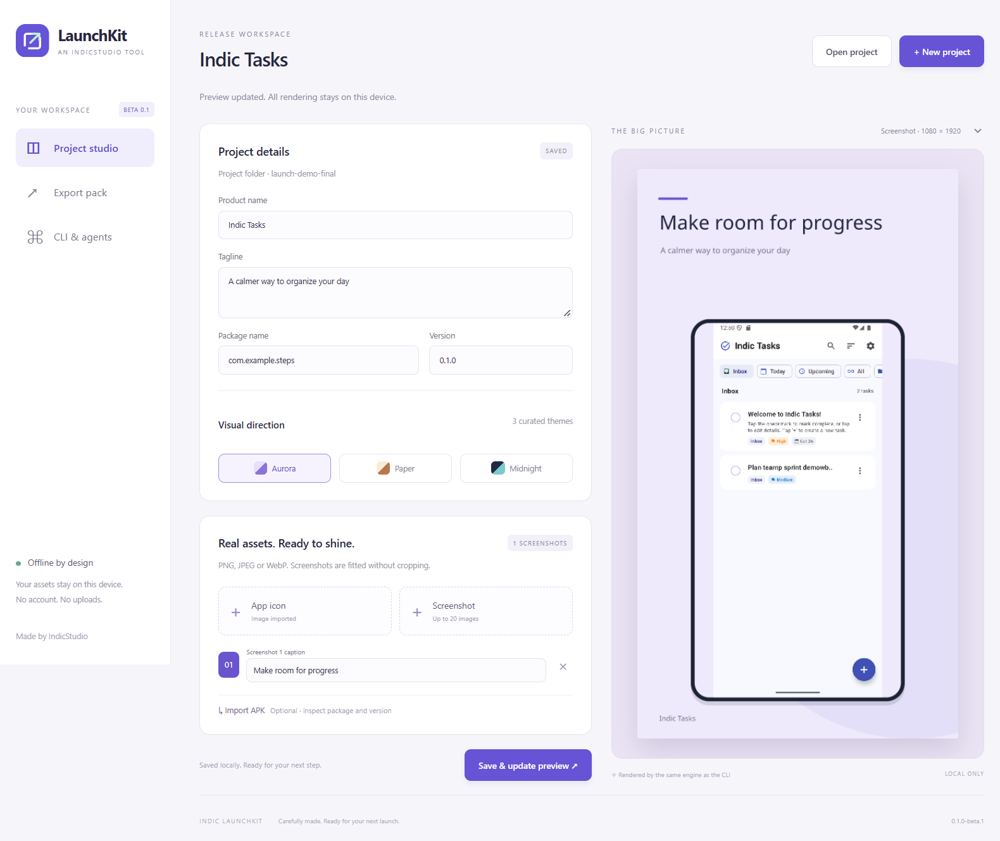

# Indic LaunchKit

An offline studio for Android release artwork, APK metadata inspection, and checksummed release packs. A native desktop interface and a separate, agent-friendly `launchkit` CLI share the same Rust engine.

**Pre-release software.** Native builds and verification are recorded in [docs/verification](docs/verification). Unsigned installers are not represented as production-signed software. APK inspection does not verify signatures or certify store acceptance.



## What it does

- Import your actual icon, screenshots, and an optional APK into a portable project folder.
- Read APK package, version, SDK requirements, size, and SHA-256 without Android build tools.
- Choose Aurora, Paper, or Midnight and edit captions with a real rendered preview.
- Export a 512px icon, 1024 × 500 feature graphic, 1200 × 630 social card, and 1080 × 1920 screenshot artwork.
- Include product metadata, an explicit review checklist, and SHA-256 checksums. Including the APK is opt-in.
- Automate the same engine with `--json`, noninteractive arguments, and stable failure codes.

No account, analytics, cloud upload, remote fonts, or online image service. It is a focused release preparation tool; it does not generate privacy policies, sign binaries, or publish to stores.

## CLI quick start

```sh
launchkit init my-app --title "My App" --package com.example.myapp --json
launchkit add --project my-app --icon icon.png --json
launchkit add --project my-app --screenshot home.png --caption "Your day, organized" --json
launchkit inspect app.apk --json
launchkit validate --project my-app --json
launchkit export --project my-app --output release-pack --dry-run --json
launchkit export --project my-app --output release-pack --json
```

`--dry-run` validates and lists planned files without writing them. The output directory must not exist; its parent must exist. See [the CLI reference](docs/CLI.md), [project format](docs/PROJECT_FORMAT.md), and [agent instructions](docs/AGENT_QUICK_START.md).

## Build from source

Requires a current stable Rust toolchain, Node.js 24+, Python 3.11+,, and the [Tauri 2 platform prerequisites](https://v2.tauri.app/start/prerequisites/). Windows uses Microsoft Edge WebView2. Linux desktop builds require WebKitGTK 4.1. The CLI does not require a WebView or a graphical desktop.

```sh
cd source_code
npm ci
cargo test -p launchkit-core -p launchkit-cli --locked
cargo build -p launchkit-cli --release --locked
npm run tauri -- dev
# Native distributables, on the target OS:
npm run tauri -- build
```

Two compiler workers are configured in `.cargo/config.toml`. No cross-platform binary is advertised until built on its corresponding runner. See [build and release](docs/BUILD_AND_RELEASE.md).

## Repository layout

| Directory | Purpose |
|---|---|
| `source_code/` | Rust workspace, Tauri shell, TypeScript/Vite interface |
| `assets/` | Original product icon and licensed bundled fonts |
| `docs/` | Requirements, architecture, CLI, product metadata, verification |
| `release/` | Immutable release records; local binaries and private material are ignored |
| `scripts/` | Validation, packaging, smoke checks, release helpers |

MIT licensed. Fonts retain their SIL Open Font License; see [third-party notices](THIRD_PARTY_NOTICES.md). Contributions welcome: [CONTRIBUTING.md](CONTRIBUTING.md).
